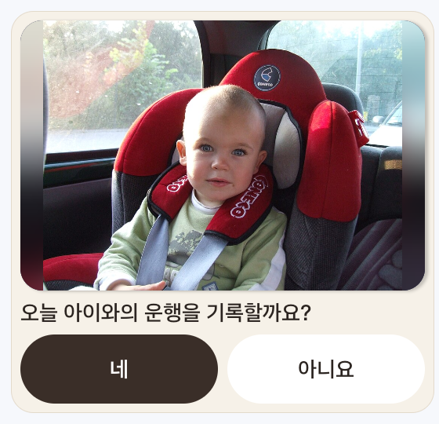
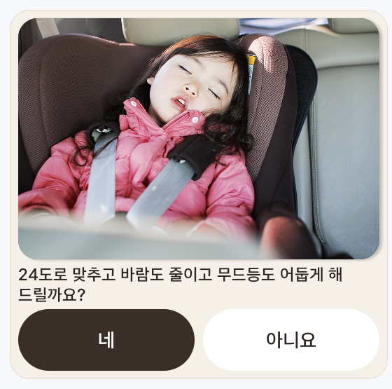
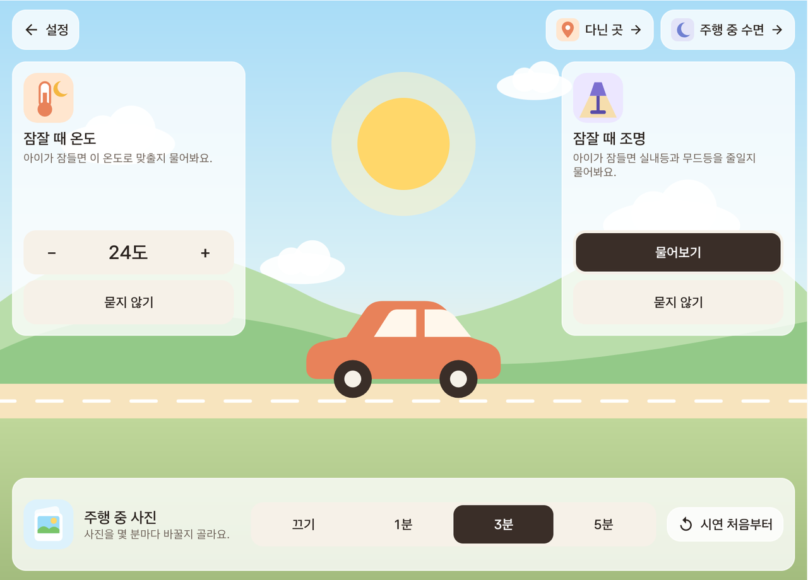
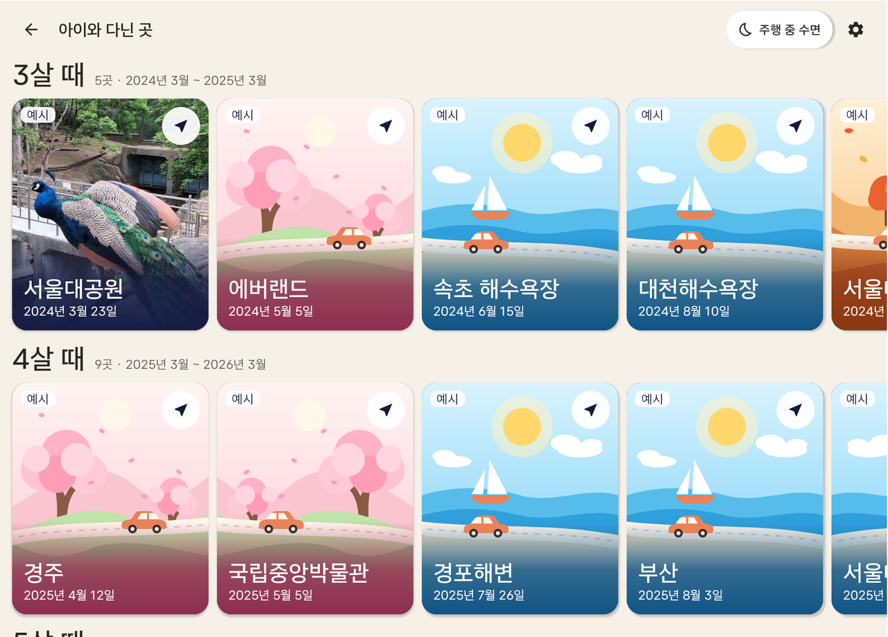
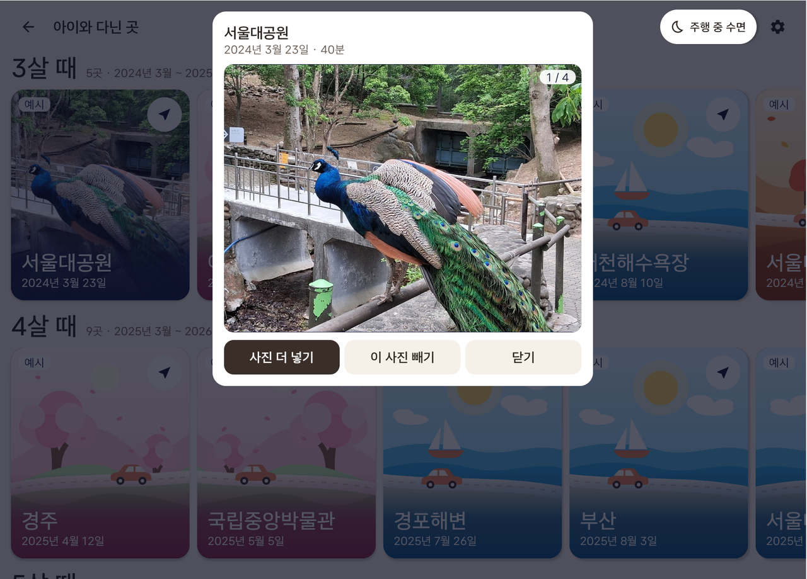
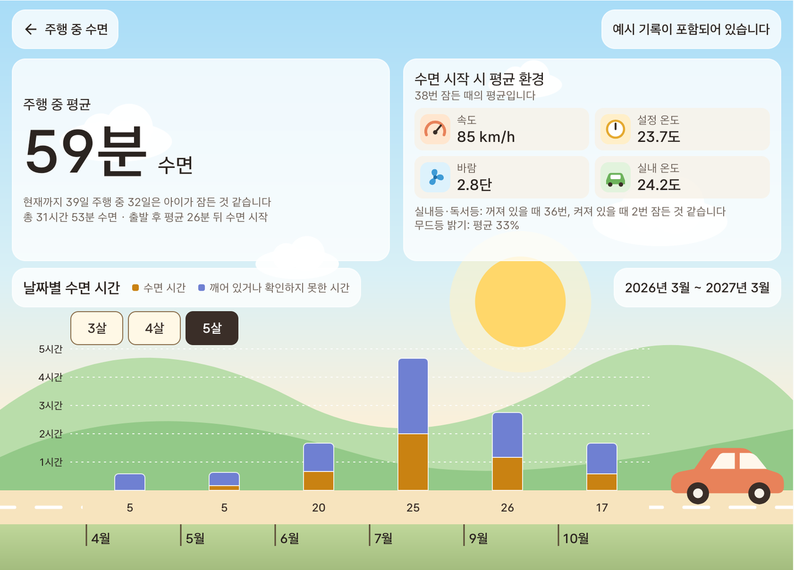
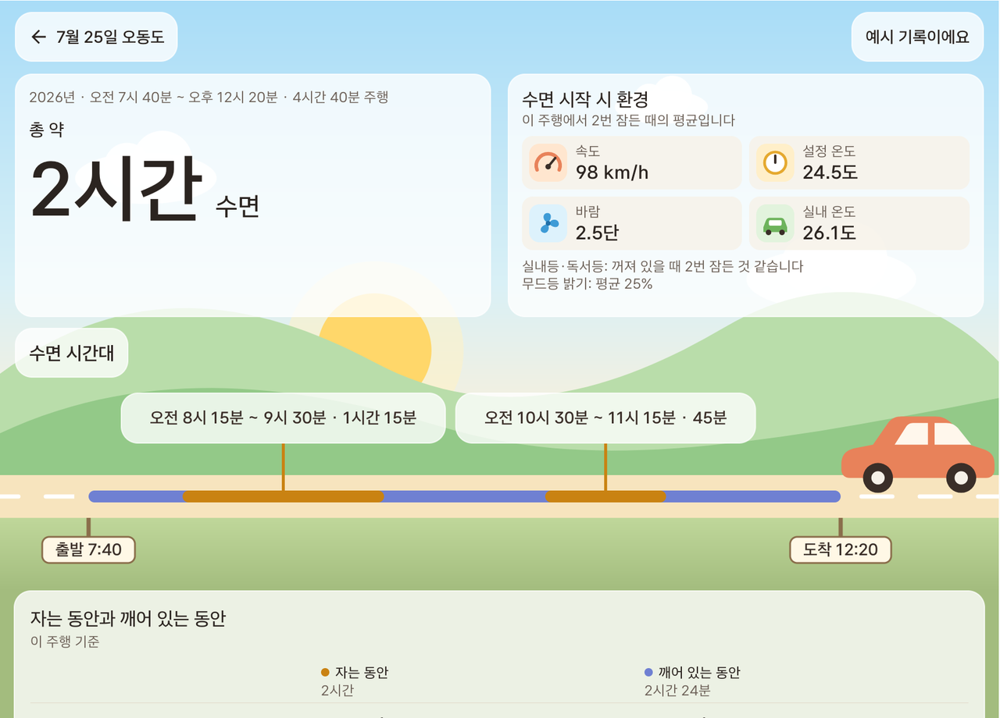

# eye-ba

뒷좌석에 탄 아이의 사진을 내비 위에 작게 띄워 주는 Pleos Connect 앱입니다. 아이를 태운 주행과 주행 중 수면도 기록합니다.

<p align="center">
  
</p>
<p align="center"><sub>Pleos Connect 에뮬레이터 v2.1.0에서 release 빌드를 실행한 화면. 가운데와 오른쪽은 에뮬레이터에 들어 있는 내비이고, 오른쪽 위 작은 창이 eye-ba입니다.</sub></p>

<p align="center">
  <a href="#바로-실행하기">바로 실행하기</a> ·
  <a href="#apk-파일-위치">APK 파일 위치</a> ·
  <a href="#테스트-환경">테스트 환경</a> ·
  <a href="#필요한-설정">필요한 설정</a> ·
  <a href="#실행-방법">실행 방법</a> ·
  <a href="#화면">화면</a> ·
  <a href="#현재-한계">현재 한계</a>
</p>

## 하는 일

- **내비 위 작은 창**: 지도 화면 오른쪽 위에 아이 사진을 작게 띄웁니다. 사진은 정한 간격(1분, 3분, 5분)마다 바뀌고, 잠들거나 울면 간격을 기다리지 않고 바뀝니다.
- **잠들면 실내 맞추기**: 아이가 잠들면 무드등을 어둡게 할지 묻습니다. 잠잘 때 온도를 정해 두었으면 공조도 함께 묻습니다. **네**를 누르면 바꾼 뒤 다시 읽은 결과를 보여 줍니다.
- **뒷창문 열림 알림**: 주행 중 뒷창문이 열리면 짧은 알림음과 함께 잠글지 묻습니다.
- **다닌 곳**: 아이를 태우고 다녀온 곳을 나이별로 모읍니다. 카드마다 사진을 10장까지 넣을 수 있습니다.
- **주행 중 수면**: 차에서 잔 시간과 잠들 때의 속도·온도·바람·조명을 나이별, 날짜별로 보여 줍니다.

## 바로 실행하기

Pleos Connect 에뮬레이터를 켜고 아래 두 줄을 실행한 다음 앱 목록에서 **eye-ba**를 엽니다.

```
adb install -r apk/안석현_eye-ba_release.apk
adb shell appops set --user 10 com.rearcare.car SYSTEM_ALERT_WINDOW allow
```

- 제대로 설치됐으면 내비가 앞으로 오고 오른쪽 위에 아이 사진이 작게 뜹니다. 이 작은 창이 앱 화면입니다.
- 둘째 줄은 다른 앱 위에 겹쳐 그리기를 허용합니다. Pleos Connect 에뮬레이터에는 이 권한을 켜는 설정 화면이 없어 adb로만 켤 수 있습니다. 이 줄을 실행하지 않으면 사진 없이 상태 카드만 있는 화면이 나옵니다.
- 운전자 사용자 번호가 10이 아니면 `adb shell am get-current-user`로 확인해 그 번호로 바꿉니다.
- 시연은 약 2분이고, 그 뒤로는 얼굴이 보이지 않는 어두운 장면만 이어집니다([시연 순서](#시연-순서)). 다시 보려면 사진을 눌러 설정 화면에 들어가 오른쪽 아래 **시연 처음부터**를 누릅니다.

## APK 파일 위치

[`apk/안석현_eye-ba_release.apk`](apk/안석현_eye-ba_release.apk)

## 테스트 환경

| 항목 | 값 |
|---|---|
| 에뮬레이터 | Pleos Connect v2.1.0 (AVD `Pleos_Connect_v2.1.0`, x86_64, 화면 2560×1440) |
| 운전자 사용자 번호 | 10 (`adb shell am get-current-user`로 확인) |
| Android | minSdk 28, targetSdk 37 |
| APK에 든 CPU 종류 | x86_64, arm64-v8a. 시험은 x86_64 에뮬레이터에서만 했습니다 |
| 서명 | 앱 마켓 배포본이 아니어서 개발용 키로 서명한 release 빌드입니다 |

## 필요한 설정

1. [바로 실행하기](#바로-실행하기)의 두 줄로 APK를 설치하고 겹쳐 그리기를 허용합니다.
2. 앱 목록에서 **eye-ba**를 엽니다. 첫 실행 때 앱에 들어 있는 시연 자료를 자동으로 준비합니다. 예시 기록이 3살, 4살, 5살로 나뉘도록 시연용 생일(2021-03-10)도 넣어 둡니다. 생일은 다닌 곳 설정에서 바꿀 수 있습니다.
3. 잠잘 때 온도는 처음에 비어 있습니다. 설정 화면의 **잠잘 때 온도**에서 정해 두면 아이가 잠들었을 때 온도도 함께 제안합니다.

## 실행 방법

앱을 켜면 내비가 앞으로 오고 오른쪽 위에 아이 사진만 작게 뜹니다. 시연은 자동으로 시작됩니다.

차량이 서 있을 때 사진을 터치하면 설정 화면으로 들어갑니다. 달리는 중에는 터치해도 열리지 않습니다. 설정 화면에서 뒤로 나오면 다시 내비와 사진만 보입니다. 설정 화면 오른쪽 아래의 **시연 처음부터**를 누르면 처음부터 다시 시작합니다. 오늘 기록할지 답한 것도 지우지만, 이미 저장된 기록은 그대로 둡니다.

### 시연 순서

실제 카메라 대신 공개 사진과 소리를 대본(`app/src/main/assets/demo/scenario.csv`) 순서대로 넣습니다. 화면에는 사진만 보이지만 앱은 사진과 소리를 함께 보고 아이 상태를 판단합니다.

| 시작 후 | 넣는 장면 | 앱의 판단 |
|---|---|---|
| 0~15초 | 정면을 보는 얼굴 | 깨어 있음 |
| 15~27초 | 고개만 돌리고 시선은 앞쪽 | 깨어 있음 |
| 27~62초 | 눈을 감은 얼굴 | 약 10초 뒤 잠듦 |
| 62~87초 | 우는 얼굴과 울음소리 | 울음 |
| 87~112초 | 정면을 보는 얼굴 | 깨어 있음 |
| 112초부터 | 얼굴이 보이지 않는 화면 | 약 10초 뒤 얼굴이 안 보임 (대본 끝까지 유지) |

사진은 설정한 간격(1분, 3분, 5분)마다 바뀌고, 처음 설치했을 때는 5분입니다. 잠듦이나 울음처럼 상태가 크게 바뀌면 간격을 기다리지 않고 바로 바뀝니다. 다만 사진과 사진 사이는 20초 이상 띄웁니다.

아이가 잠들면 사진 아래에 제안이 나옵니다. 잠잘 때 온도를 정하지 않았으면 "무드등을 어둡게 해 드릴까요?", 정했으면 온도까지 함께 묻습니다. 차량이 P단에 서 있고 실내등이나 독서등이 켜져 있으면 그 불을 끌지도 묻습니다. **네**를 누르면 차량의 공조와 조명을 바꿉니다.

### 주행 기록

1. 앱을 켠 뒤 차량이 P단이면 사진 아래에 "오늘 아이와의 운행을 기록할까요?"라고 묻습니다. **네**를 눌러야 기록합니다. 아이가 보이든 안 보이든 묻습니다.
2. **네**를 처음 누르면 시스템 권한 창이 뜹니다. Android가 속도 값을 위치 권한 묶음에 넣어 두어서 창에는 "위치 정보"라고 나옵니다. 허용하면 수면 통계에 속도도 들어갑니다.
3. 버추얼 콘솔에서 기어를 D로 바꾸고 30초 이상 지난 뒤 P로 바꿉니다. 그러면 주행이 저장되고 "…을 기록했어요."가 뜹니다. 30초보다 짧으면 저장하지 않습니다.
4. 앱을 다시 켜서 같은 날 또 주행하면 묻지 않고 그날의 기록에 합칩니다. 세워 둔 시간은 주행 시간에서 뺍니다. "아니요"라고 답했으면 다음에 앱을 켤 때 다시 묻습니다.

### 다닌 곳과 주행 중 수면

설정 화면 오른쪽 위의 **다닌 곳**과 **주행 중 수면**을 누릅니다.

- **다닌 곳**: 나이별 기록을 봅니다. **예시** 표시가 붙은 39개는 시연용으로 만든 기록이라 실제로 다녀온 곳이 아닙니다. 카드를 누르면 차량에 저장된 사진을 카드 하나에 10장까지 넣을 수 있습니다. 카드에는 첫 사진만 보이고 나머지는 카드를 누른 창에서 옆으로 밀어 봅니다. 예시 기록은 사진만 넣거나 뺄 수 있고 지우지는 못합니다.
- **주행 중 수면**: 통계를 봅니다. 나이 표지판을 누르면 그 나이의 기록이 나옵니다. 한 화면에 다 들어가지 않으면 옆으로 밀거나 오른쪽 위 화살표로 달을 넘깁니다. 막대는 날짜마다 하나이고, 일은 길 위에, 달과 해는 길 아래에 적습니다. 막대를 누르면 그날 기록을 자세히 볼 수 있습니다.

## 화면

<table>
  <tr>
    <td align="center" width="50%"><br><sub>앱을 켰을 때 P단이면 오늘 운행을 기록할지 묻습니다</sub></td>
    <td align="center" width="50%"><br><sub>아이가 잠들면 실내를 맞출지 묻습니다(잠잘 때 온도를 24도로 정해 둔 상태)</sub></td>
  </tr>
  <tr>
    <td align="center"><br><sub>설정: 잠잘 때 온도와 조명, 주행 중 사진 간격</sub></td>
    <td align="center"><br><sub>다닌 곳: 나이별 기록(<b>예시</b> 표시는 시연용)</sub></td>
  </tr>
  <tr>
    <td align="center"><br><sub>카드를 누른 창: 사진 넣기와 빼기</sub></td>
    <td align="center"><br><sub>주행 중 수면: 나이별, 날짜별 통계</sub></td>
  </tr>
  <tr>
    <td align="center" colspan="2"><br><sub>막대를 누른 그날 화면(7월 25일 예시 기록)</sub></td>
  </tr>
</table>

그림은 2026-11-10~11에 Pleos Connect 에뮬레이터 v2.1.0에서 release 빌드를 실행해 찍었습니다. 그림에 나온 사진의 출처는 [아래](#그림에-나온-사진)에 있습니다.

## 현재 한계

- 실제 뒷좌석 카메라는 아직 연결하지 않았습니다. 시연은 공개 사진과 소리로 상황을 흉내 낸 것이고 실제 아이를 촬영하거나 녹음하지 않았습니다.
- 잠듦 판단은 시연에서만 10초로 줄였습니다. 기본값은 60초입니다.
- 앱은 시동 신호를 읽지 못합니다(Pleos Vehicle SDK 2.3.2에 읽는 함수가 없습니다). 그래서 기록 여부는 앱을 켠 뒤 P단일 때 묻고, 주행은 P단에 둘 때마다 저장합니다. 실제 차량에서는 시험하지 않았습니다.
- 앱이 보여 주는 상태는 사진과 소리로 추정한 값입니다. 아이의 건강이나 호흡을 살피지 않으며 아이를 차량에 두고 내리는 일을 막아 주지도 않습니다.

## 소스에서 빌드

Android Studio의 JDK와 Android SDK 37이 필요합니다. SDK 위치는 `local.properties`나 `ANDROID_HOME`으로 지정합니다. Pleos SDK는 `settings.gradle.kts`에 적힌 공개 저장소에서 받습니다.

```
./gradlew :app:assembleRelease
```

결과 파일은 `app/build/outputs/apk/release/app-release.apk`입니다.

## 사용한 자료의 출처

- 모델, 아이콘, 라이브러리, 시연 사진과 소리의 출처와 사용 조건: [`THIRD_PARTY_NOTICES.md`](THIRD_PARTY_NOTICES.md)
- 시연 파일별 출처표: [`app/src/main/assets/demo/SOURCES.csv`](app/src/main/assets/demo/SOURCES.csv)

### 그림에 나온 사진

- 깨어 있는 아이: `c0362.jpg`, Joymaster, 퍼블릭 도메인
- 잠든 아이: `c0401.jpg`, MIKI Yoshihito, [SAKIKO takes a nap](https://commons.wikimedia.org/wiki/File:SAKIKO_takes_a_nap_%2847391925661%29.jpg), [CC BY 2.0](https://creativecommons.org/licenses/by/2.0/). 작은 창에 맞게 잘려 보입니다.
- 다닌 곳의 서울대공원 카드 사진: 사진 넣기를 시험하려고 에뮬레이터 갤러리에 넣은 것이라 APK에는 없습니다. 네 장 모두 Drcbrothephotographer가 서울대공원에서 찍은 Wikimedia Commons의 CC0 사진이고, 그림에 보이는 것은 [Common peafowl cock with stretching wings](https://commons.wikimedia.org/wiki/File:Common_peafowl_cock_with_stretching_wings.jpg)입니다.
