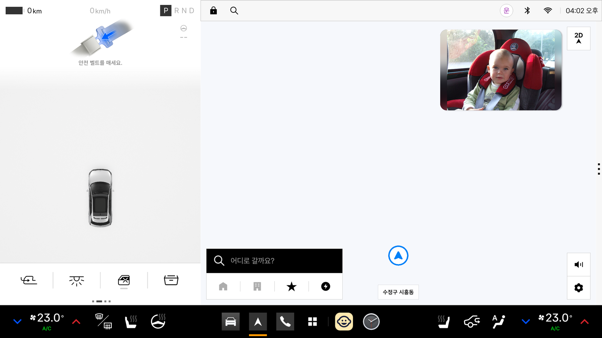

# eye-ba

내비 위에 뒷좌석 아이의 사진을 작게 띄우고, 아이와의 주행과 주행 중 수면을 기록하는 Pleos Connect 앱입니다.

앱 목록에 보이는 이름은 **eye-ba**입니다.

## 바로 실행하기

Pleos Connect 에뮬레이터를 켠 뒤 아래 두 줄을 실행하고, 앱 목록에서 **eye-ba**를 엽니다.

```
adb install -r apk/<팀명>_eye-ba_release.apk
adb shell appops set --user 10 com.rearcare.car SYSTEM_ALERT_WINDOW allow
```

- **정상이면 내비가 앞으로 오고, 내비 오른쪽 위에 아이 사진이 작게 뜹니다(아래 그림).** 이 앱의 화면은 이 작은 창입니다.
- 둘째 줄은 다른 앱 위에 겹쳐 그리기를 허용하는 명령입니다. Pleos Connect 에뮬레이터에는 이 권한을 켜는 설정 화면이 없어서 adb 명령으로만 켤 수 있습니다. 실행하지 않으면 사진 없이 상태 카드만 있는 앱 화면이 나옵니다.
- 운전자 사용자 번호가 10이 아니면 `adb shell am get-current-user`로 확인해 그 번호로 바꿉니다.
- 시연은 대본대로 약 2분 동안 진행되고, 그 뒤로는 얼굴이 보이지 않는 어두운 장면이 이어집니다(아래 [1. 아이 상태](#1-아이-상태)의 표). 처음부터 다시 보려면 사진을 눌러 설정 화면으로 들어가 오른쪽 아래의 **시연 처음부터**를 누릅니다.



그림: Pleos Connect 에뮬레이터 v2.1.0에서 release 빌드를 실행한 화면입니다(2026-11-10). 가운데·오른쪽은 에뮬레이터에 들어 있는 내비이고, 오른쪽 위 작은 창이 이 앱입니다. 사진을 누르면 설정 화면이 열립니다. 아이 사진은 시연용 퍼블릭 도메인 사진(`app/src/main/assets/demo/c0362.jpg`, 출처는 [`THIRD_PARTY_NOTICES.md`](THIRD_PARTY_NOTICES.md))입니다.

## APK 파일 위치

`apk/<팀명>_eye-ba_release.apk`

## 테스트 환경

| 항목 | 값 |
|---|---|
| 에뮬레이터 | Pleos Connect v2.1.0 (AVD `Pleos_Connect_v2.1.0`, x86_64, 화면 2560×1440) |
| 운전자 사용자 번호 | 10 (`adb shell am get-current-user`로 확인) |
| Android | minSdk 28, targetSdk 37 |
| APK에 든 CPU 종류 | x86_64, arm64-v8a. 시험은 x86_64 에뮬레이터에서만 했습니다 |
| 서명 | 앱 마켓 배포본이 아니어서 개발용 키로 서명한 release 빌드입니다 |

## 필요한 설정

1. 위 [바로 실행하기](#바로-실행하기)의 두 줄로 APK를 설치하고 겹쳐 그리기를 허용합니다.

2. 앱 목록에서 **eye-ba**를 엽니다. 첫 실행 때 앱에 들어 있는 시연 자료를 자동으로 준비합니다. 예시 기록이 3살, 4살, 5살로 나뉘도록 시연용 생일(2021-03-10)도 함께 넣습니다. 생일은 다닌 곳 설정에서 바꿀 수 있습니다.

3. 잠잘 때 온도는 처음에 정해져 있지 않습니다. 설정 화면의 **잠잘 때 온도**에서 정하면, 잠들었을 때 온도까지 함께 제안합니다.

## 실행 방법

앱을 켜면 내비가 앞으로 오고 오른쪽 위에 아이 사진만 작게 뜹니다. 아래 시연은 자동으로 시작됩니다.

차가 서 있을 때 사진을 터치하면 설정 화면으로 들어갑니다. 달리는 중에는 터치해도 열리지 않습니다. 설정 화면에서 뒤로 나오면 다시 내비와 사진만 보입니다.

설정 화면 오른쪽 아래의 **시연 처음부터**를 누르면 처음부터 다시 시작합니다. 오늘의 기록 여부 답도 지우지만, 저장된 기록은 지우지 않습니다.

### 1. 아이 상태

실제 카메라 대신 공개 사진과 소리를 대본 순서대로 넣습니다. 대본은 `app/src/main/assets/demo/scenario.csv`입니다. 화면에는 사진만 보이고, 앱은 사진과 소리로 아이의 상태를 판단합니다.

| 시작 후 | 넣는 장면 | 앱의 판단 |
|---|---|---|
| 0~15초 | 정면을 보는 얼굴 | 깨어 있음 |
| 15~27초 | 고개만 돌리고 시선은 앞쪽 | 깨어 있음 |
| 27~62초 | 눈을 감은 얼굴 | 약 10초 뒤 잠듦 |
| 62~87초 | 우는 얼굴과 울음소리 | 울음 |
| 87~112초 | 정면을 보는 얼굴 | 깨어 있음 |
| 112초부터 | 얼굴이 보이지 않는 화면 | 약 10초 뒤 얼굴이 안 보임 (대본 끝까지 유지) |

사진은 설정한 간격(1분, 3분, 5분)마다 바뀌고, 처음 설치했을 때는 5분입니다. 잠듦, 울음처럼 상태가 크게 바뀌면 20초 간격 안에서 먼저 바뀝니다.

잠들었을 때는 차가 서 있으면 사진 아래에 제안이 나옵니다. 잠잘 때 온도를 정하지 않았으면 "무드등을 어둡게 해 드릴까요?", 정했으면 온도까지 함께 묻습니다. **네**를 누르면 차의 공조와 무드등을 바꿉니다.

### 2. 주행 기록

1. 앱을 켠 뒤 차가 P단이면 사진 아래에 "오늘 아이와의 운행을 기록할까요?"라고 묻습니다. **네**를 눌러야 기록합니다. 아이가 보이는지와는 상관없이 묻습니다.
2. **네**를 처음 누르면 시스템 권한 창이 뜹니다. Android가 속도 값을 위치 권한 묶음으로 분류해 "위치 정보"라고 표시됩니다. 허용하면 수면 통계에 속도가 포함됩니다.
3. 버추얼 콘솔에서 기어를 D로 바꾸고 30초 이상 지난 뒤 P로 바꿉니다. 그 주행이 저장되고 "…을 기록했어요."가 나옵니다. 30초보다 짧으면 저장하지 않습니다.
4. 앱을 다시 켜서 같은 날 또 주행하면 묻지 않고 그날의 기록에 합칩니다. 세워 둔 시간은 주행 시간에서 뺍니다. "아니요"라고 답했으면 다음에 앱을 켤 때 다시 묻습니다.

### 3. 다닌 곳과 주행 중 수면

사진을 터치해 설정 화면으로 들어간 뒤 오른쪽 위의 **다닌 곳**과 **주행 중 수면**을 누릅니다.

- **다닌 곳**: 나이별 기록을 봅니다. **예시** 표시가 붙은 39개는 시연용으로 만든 기록이고, 실제로 다녀온 기록이 아닙니다. 카드를 누르면 차에 저장된 사진을 카드 하나에 10장까지 넣을 수 있습니다. 카드에는 첫 사진이 보이고, 카드를 누른 창에서 옆으로 밀어 나머지 사진을 봅니다. 예시 기록은 사진만 넣거나 뺄 수 있고 지우지는 못합니다.
- **주행 중 수면**: 통계를 봅니다. 나이 표지판을 누르면 그 나이의 기록이 보이고, 한 화면을 넘으면 옆으로 밀거나 오른쪽 위의 화살표로 달을 넘깁니다. 막대는 날짜마다 하나이고, 일은 길 위, 달과 해는 길 아래에 씁니다. 막대를 누르면 그날을 자세히 봅니다.

## 현재 한계

- 실제 뒷좌석 카메라는 아직 연결하지 않았습니다. 시연은 공개 사진과 소리로 상황을 흉내 낸 것이며, 실제 아이를 촬영하거나 녹음하지 않았습니다.
- 잠듦 판단은 시연에서만 10초로 줄였습니다. 기본값은 60초입니다.
- 앱은 시동 신호를 읽지 못합니다(Pleos Vehicle SDK 2.3.2에 읽는 함수가 없습니다). 그래서 앱을 켠 뒤 P단일 때 묻고, P단에 둘 때마다 주행을 저장합니다. 실제 차에서는 시험하지 않았습니다.
- 앱이 보여 주는 상태는 사진과 소리로 추정한 값입니다. 아이의 건강이나 호흡을 살피는 기능이 아니고, 아이를 차에 두고 내리는 일을 막아 주는 기능도 아닙니다.

## 소스에서 빌드

Android Studio의 JDK와 Android SDK 37이 필요합니다. SDK 위치는 `local.properties`나 `ANDROID_HOME`으로 지정합니다. Pleos SDK는 `settings.gradle.kts`에 적힌 공개 저장소에서 받습니다.

```
./gradlew :app:assembleRelease
```

결과 파일은 `app/build/outputs/apk/release/app-release.apk`입니다.

## 사용한 자료의 출처

- 모델, 아이콘, 라이브러리, 시연 사진과 소리의 출처와 사용 조건: [`THIRD_PARTY_NOTICES.md`](THIRD_PARTY_NOTICES.md)
- 시연 파일별 출처표: [`app/src/main/assets/demo/SOURCES.csv`](app/src/main/assets/demo/SOURCES.csv)
